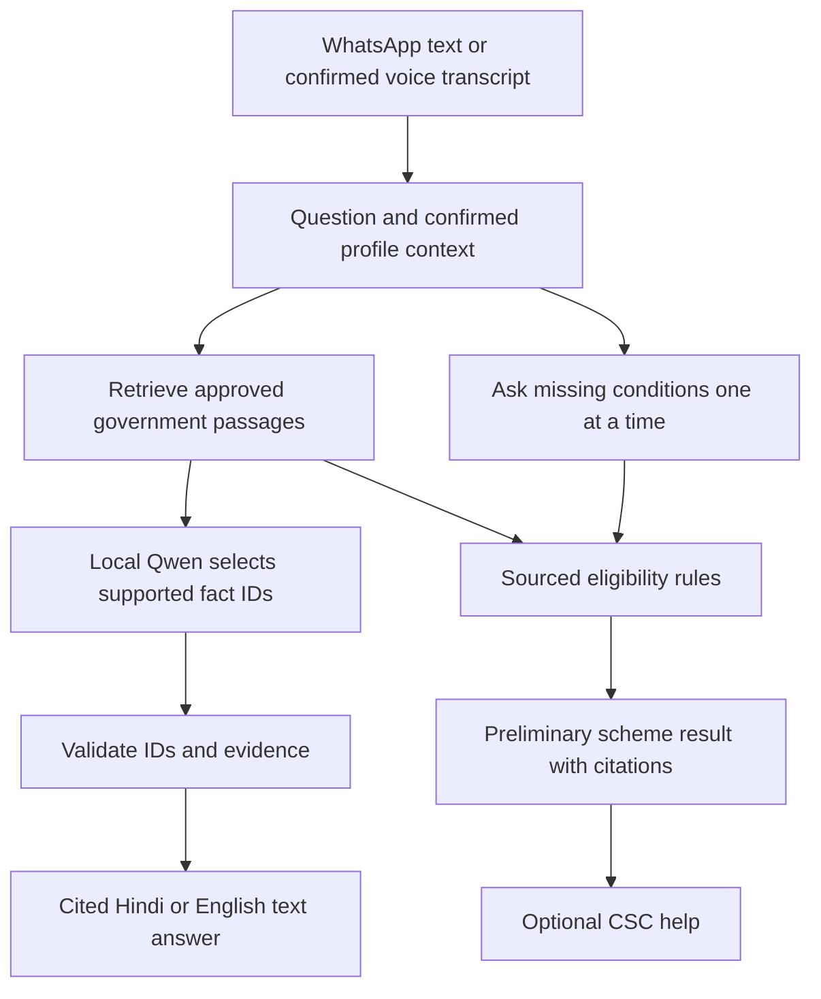

# Yojana Sahayak

**सरकारी योजनाओं की जानकारी, आसान भाषा में।**

Government scheme guidance through WhatsApp, in Hindi and English.

Yojana Sahayak helps people ask **“Which scheme may fit me?”, “What documents do I need?” and “Where can I apply?”** It combines public government evidence, a short conversation and preliminary rule checks, with a source link for each factual answer.

**Hackathon prototype · WhatsApp + web · Hindi + English**

> **For judges:** the current demo implementation is on [`captain/server-integration`](https://github.com/CPTECH47/yojana-sahayak/tree/captain/server-integration). The `main` branch contains the earlier pilot; use the demo branch for the features and setup below. This is an independent student project. A possible match is preliminary guidance, not government approval.

## Problem statement

Scheme information is spread across government portals, notices and long PDFs. People may struggle to understand eligibility, find the right documents or know where to get help. Language and unfamiliar websites add another barrier.

Our goal is to make that first conversation easier for farmers, students, workers, artisans and families, while keeping the official source visible.

## Solution

The user talks to one WhatsApp assistant instead of searching several portals. They choose a language, describe their situation or answer one question at a time, and receive the best fit among the reviewed scheme checks, with reasons and citations. Missing information triggers a follow-up rather than an assumed answer.

A companion website lists scheme information and opens WhatsApp with a prepared starting message. After a completed scheme result, the bot offers optional service-centre help.

## Demo

The current demo runs locally with a paired WhatsApp account. No public production deployment is documented.

1. Send **`YOJANA START`** to the team's running demo bot from a consenting second account.
2. Choose **1 — Hindi** or **2 — English**.
3. Choose a role, or describe a fictional situation such as “I am a farmer and earn ₹500.” The bot asks for missing context, including whether that income is daily, monthly or yearly.
4. Answer the relevant conditions one at a time. Correct, skip or go back when needed.
5. Receive a short preliminary result with an official source. Other schemes' calculations stay out of the WhatsApp result.
6. Ask a scheme question in text, or send a short Hindi/English voice note in the active conversation. Confirm the displayed transcript before it is used.
7. After the result, choose whether you want nearby service-centre help. Only then provide a PIN code or town to open a Maps search or the official CSC locator.

For voice, try: **“पीएम किसान योजना में सालाना कितने रुपये मिलते हैं?”** To demonstrate an evidence gap, ask something the reviewed documents do not establish: the bot should explain that it could not confirm the answer from its official sources.

## Features

- **Hindi and English:** bilingual prompts, reviewed answers and source citations.
- **Stepwise conversation:** one missing eligibility condition per message, with correction, back, skip and cancel controls.
- **Natural descriptions:** local Qwen proposes structured profile details; the user confirms them before matching. Ambiguous income periods are clarified.
- **Six scheme checks:** selected conditions for agriculture, pensions, scholarships, artisans and household LPG support.
- **Short results:** the highest-ranked non-excluded checked scheme, a reason, any missing information and the evidence. If all checked schemes are excluded, the bot says no suitable result was found.
- **Voice input:** Sarvam transcription or optional local faster-whisper, followed by confirmation and a cited text response.
- **Companion website:** a mobile-friendly bilingual directory, official citations and a WhatsApp handoff. The visitor presses Send on the prepared message.
- **CSC help:** consent first, then PIN/town, followed by a Google Maps search and the [official CSC locator](https://locator.csccloud.in/). Map listings are not verified CSC records.
- **Source monitoring:** selected official pages are checked every 12 hours while the bot runs. Discoveries remain review candidates until approved.
- **Spam and cost controls:** admission before media download or AI calls, text/voice limits, duplicate-event checks, bounded concurrency and evidence-bound model-selection caching.
- **Optional saved progress:** explicit `SAVE` consent for 30-day encrypted local retention; separate alert consent and `STOP`/`DELETE` controls.

## Scheme and evidence coverage

| Audience | Scheme | Current check scope |
| --- | --- | --- |
| Farmers | PM-KISAN | Selected landholding and exclusion conditions |
| Farmers | PM Kisan Maandhan (PM-KMY) | Selected pension entry and exclusion conditions |
| Students | National Means-cum-Merit Scholarship Scheme (NMMSS) | Selected fresh Class IX conditions; not a live deadline check |
| Workers | PM Shram Yogi Maandhan (PM-SYM) | Selected age, income, work and coverage conditions |
| Artisans | PM Vishwakarma | Selected registration conditions |
| Families | PM Ujjwala Yojana (PMUY) | Selected applicant, household LPG and declaration conditions |

**Evidence check on 1 November 2026:** 11 runtime-usable official documents/pages, 18 supported answer records and six scheme areas. Two time-sensitive scholarship sources expired after 31 October and are excluded automatically. Counts change with source expiry; run `npm.cmd run check:release` for the current result.

The PM-KMY, NMMSS policy and PM Vishwakarma policy additions have been compared against their official sources, but independent team review remains pending before public release. Coverage is limited to the reviewed conditions and passages, not every rule or every Indian scheme. See [coverage and review notes](https://github.com/CPTECH47/yojana-sahayak/blob/captain/server-integration/docs/NATIONAL_ROLE_COVERAGE.md).

## How RAG and the AI work

RAG means **retrieval-augmented generation**: find relevant evidence before constructing the answer. We constrain the model further by allowing it to select approved fact IDs; code renders the corresponding reviewed Hindi/English text and citations.



Each usable passage must match its approved source metadata, snapshot hash and passage digest, and must not be expired. Retrieval uses scheme context and Hindi/English term matching. The model's freely written claims, amounts and links are not shown as factual answers. Eligibility results come from sourced code rules, not model opinion.

If evidence is missing or insufficient, the bot explains what it could not confirm. If the model is unavailable, it can return a labelled extractive fallback from supported records. These safeguards reduce unsupported answers; they do not guarantee perfect relevance or complete policy coverage.

### New government information

The updater follows configured official sources, stores candidate snapshots and detects changes. It does **not** automatically approve new benefits, deadlines or eligibility rules. Reviewed publication is required before new facts enter answers. myScheme, India.gov.in and data.gov.in are discovery references, not substitutes for the issuing authority's evidence.

## Tech stack

| Layer | Technology |
| --- | --- |
| WhatsApp connection | Node.js and Baileys |
| Shared answer API | Express |
| Website | React and Vite |
| Local language model | Ollama, Qwen 3 4B |
| Retrieval and eligibility | Approved passages, pinned bilingual facts and evidence-linked rules |
| Speech recognition | Sarvam Saaras v4; optional local faster-whisper |
| Evidence ingestion and monitoring | Python, source snapshots, SHA-256 and review metadata |
| Local persistence | Encrypted local state with explicit save consent |
| Optional database practice endpoint | Supabase; not the established primary scheme/profile store |
| Verification | Node test runner, Python unittest and Vite build |

## Run locally on Windows

Install **Node.js 20.19+**, Git and Ollama. Python is needed for local speech recognition and source-monitoring tools.

```powershell
git clone --branch captain/server-integration https://github.com/CPTECH47/yojana-sahayak.git
Set-Location yojana-sahayak
npm.cmd ci
if (!(Test-Path .env)) { Copy-Item .env.example .env }
ollama pull qwen3:4b
npm.cmd run build
npm.cmd start
```

Keep Ollama running. The default website is [http://127.0.0.1:3000](http://127.0.0.1:3000); use the configured `PORT` if changed. `/api/health` reports the active corpus count. `/api/ready` additionally checks the minimum corpus size and model availability. Supabase credentials are optional for this core journey.

In another PowerShell terminal, from the same project directory:

```powershell
node server/whatsapp-prototype.mjs
```

Follow the local linked-device pairing instructions. Keep only one bot process using a given session. After `WhatsApp connected`, send **`YOJANA START`** from the consenting second account and observe the reply; a connected terminal alone does not verify the conversation.

Baileys uses WhatsApp Web and is not an official WhatsApp Business API integration. The personal-number prototype keeps an explicit start prefix so unrelated chats do not activate it. A dedicated, tested number and an approved transport are future production work.

### Voice input

For Sarvam, put `YOJANA_STT_PROVIDER=sarvam` and your `SARVAM_API_KEY` in the private `.env`, then restart the bot. This sends recordings to Sarvam, needs internet and consumes provider credits. Never ask users to record personal identifiers or financial details.

For the optional local provider, install FFmpeg and the speech dependencies:

```powershell
python -m venv .runtime\voice-venv
.\.runtime\voice-venv\Scripts\python.exe -m pip install -r requirements-voice.txt
```

Use `YOJANA_STT_PROVIDER=local` and restart. The default faster-whisper model downloads on first use; recognition quality depends on the recording and hardware. In an active conversation, send a short voice note directly. Reply **1** to confirm the transcript or **2** to record again; `YOJANA EDIT <correct sentence>` corrects it before confirmation.

Current voice output is **cited text**. Automatic same-language switching and Edge TTS audio replies are planned enhancements, not implemented features in this snapshot. Sarvam correctly transcribed a paired-phone Hindi question in the recorded test; that does not establish accuracy for every speaker or language.

## API overview

| Endpoint | Purpose |
| --- | --- |
| `POST /api/chat` | Source-backed answer, language, status and citations |
| `POST /api/recommend` | Single or multiple scheme profiles; preliminary results, reasons, missing fields and citations |
| `GET /api/catalog` | Public bilingual facts backed by usable evidence |
| `GET /api/health` | Service health and usable corpus count |
| `GET /api/ready` | Corpus threshold and model availability |
| `GET /api/prep-status` | Separate optional Supabase practice read |
| `GET /start-whatsapp` | Prepared WhatsApp starting message |

Exact fields and scheme additions are in the [project brief](https://github.com/CPTECH47/yojana-sahayak/blob/captain/server-integration/PROJECT_BRIEF.md) and [multi-scheme contract](https://github.com/CPTECH47/yojana-sahayak/blob/captain/server-integration/docs/MULTI_SCHEME_AND_DAILY_REVIEW.md). Binding beyond localhost requires `API_ACCESS_TOKEN`; keep it server-side.

## Verify

```powershell
npm.cmd test
npm.cmd run build
npm.cmd run check:release
```

For ingestion and updater checks:

```powershell
python -m pip install -r requirements-ingest.txt
npm.cmd run test:ingest
```

The last recorded implementation checks passed **139 Node tests**, **13 Python tests** and the production build. Tests cover evidence expiry/tampering, unsupported questions, fictional match/exclusion/missing-answer cases, corrections, CSC consent, voice failure handling, deduplication and rate limits. Mocked speech and transport tests do not prove handset accuracy, live delivery or public deployment. The dated corpus check above is separate from those recorded test results.

## Privacy and current limits

- Use fictional profiles for the hackathon. Do not send Aadhaar, PAN numbers, bank details, OTPs or private documents.
- Never commit `.env`, API keys, Baileys session files, recordings or saved user state. Configure secrets privately; [`.env.example`](https://github.com/CPTECH47/yojana-sahayak/blob/captain/server-integration/.env.example) contains placeholders only.
- Source-backed document/application guidance is limited to supported records. The bot does not submit applications or generate official documents.
- CSC help opens a search; it does not provide a verified nearest-centre ranking, guaranteed availability or confirmed contact details.
- The 12-hour local updater stops when the bot/laptop stops. Cloud scheduling and continuous deployment need separate verification.
- SMS, offline access, tested regional languages beyond Hindi/English, and spoken audio answers remain future work.

## Guides

- [Conversation flow and commands](https://github.com/CPTECH47/yojana-sahayak/blob/captain/server-integration/docs/WHATSAPP_FLOW.md)
- [Source review and publication](https://github.com/CPTECH47/yojana-sahayak/blob/captain/server-integration/docs/SOURCE_GOVERNANCE.md)
- [Source-monitor integration checks](https://github.com/CPTECH47/yojana-sahayak/blob/captain/server-integration/docs/PR10_INTEGRATION_CHECK.md)
- [Spam controls and backend-call savings](https://github.com/CPTECH47/yojana-sahayak/blob/captain/server-integration/docs/SPAM_PROTECTION.md)
- [Detailed hardening and operations notes](https://github.com/CPTECH47/yojana-sahayak/blob/captain/server-integration/docs/HARDENING.md) — an earlier audit snapshot; use the dated coverage notes above for current counts and scheme scope.
